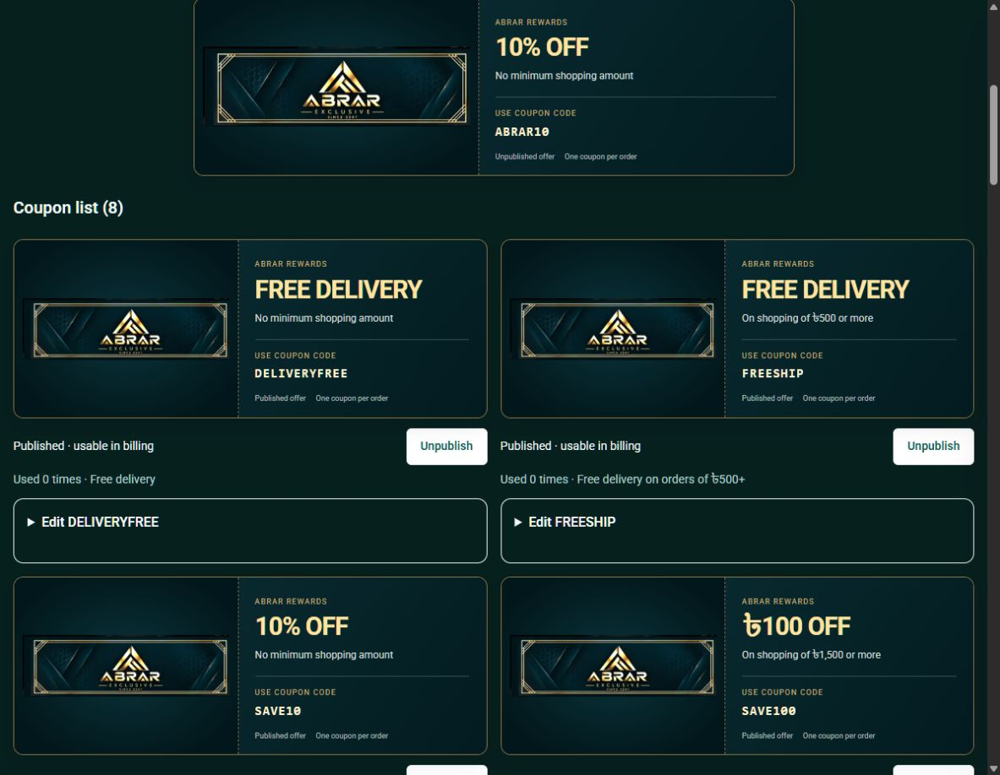
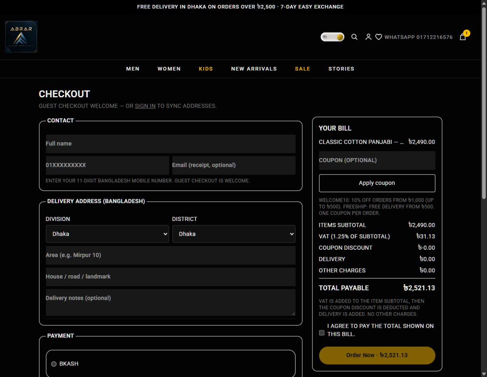
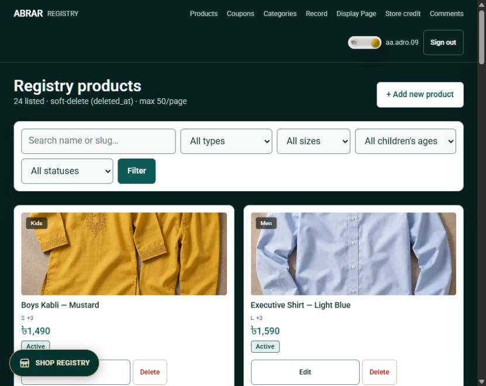
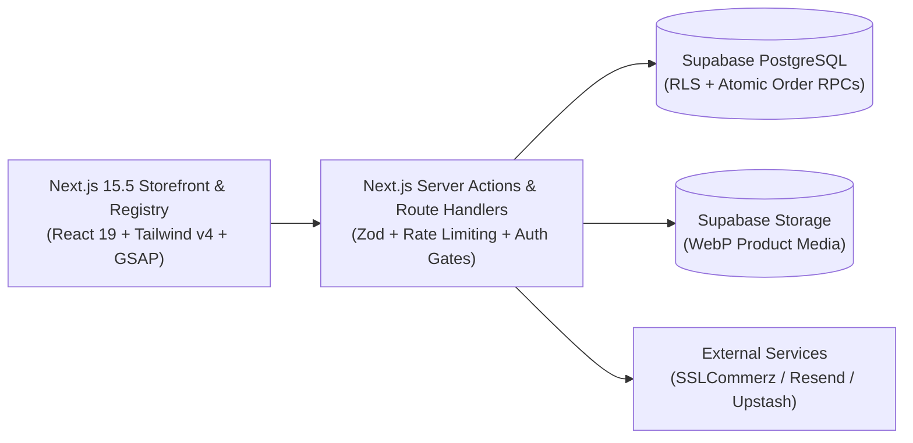

# ABRAR-EXCLUSIVE — Flagship Fashion E-Commerce Platform

> **Official Public Showcase Repository**  
> **Tagline:** *Quality, beauty and elegance.* — Dhaka, Bangladesh  
> **Live Website:** [https://www.abrar-exclusive.shop/](https://www.abrar-exclusive.shop/)

---

> [!IMPORTANT]
> **Proprietary Source Code Notice**  
> To protect proprietary business logic, custom design systems, and security architecture, the full production source code for **ABRAR-EXCLUSIVE** is maintained in a **private repository** and is **not available for public download, cloning, or redistribution**.  
> This public repository serves exclusively as a project showcase and architectural overview.

---

## Overview

**ABRAR-EXCLUSIVE** is a full-stack luxury and contemporary fashion e-commerce platform built for the Bangladeshi market, featuring collections across **Men, Women, and Kids** with bilingual (**English & Bangla**) support and integer-paisa **BDT (৳)** financial precision.

### Core Capabilities

- **Obsidian Leather Studio & Atmospheric Storefront**
  - Bespoke editorial UI with GSAP-driven section light motion, Lenis smooth scrolling, glassmorphic navigation, and adaptive theme surfaces.
  - Deep 64-leaf category taxonomy across **Men (14)**, **Women (14)**, **Boys (16)**, and **Girls (20)** with instant mega-menu previews and child-age filtering.
- **Precision BDT (৳) Checkout & Billing**
  - Integer-paisa pricing engine with itemized checkout receipts, printable bills, and server-side atomic stock validation via Supabase RPC (`create_order`).
  - Supports **Cash on Delivery (COD)**, **Manual Mobile Banking Review (bKash / Nagad)**, and **SSLCommerz** payment gateway integration.
- **Customer Accounts, Wallet & Promotions**
  - Customer dashboard with order timeline tracking (`BR-…`), saved BD district/division addresses, store-credit wallet, and long copyable promotional coupons with interactive celebration states.
- **Registry & Admin Control Plane**
  - Live product & variant inventory management, multi-image Supabase Storage pipeline, coupon activation, order fulfillment workflows, and customer review moderation.
- **Interactive Store Guide Assistant**
  - Floating context-aware shopping assistant for catalog discovery, sizing guidance, and order navigation.

---

## Visual Previews

### Storefront Promotions & Coupon Experience

### Itemized Checkout & Printable Billing

### Registry & Inventory Control Plane

---

## Tech Stack & Architecture

| Layer | Technology |
| :--- | :--- |
| **Framework** | Next.js 15.5 (App Router), React 19, TypeScript (Strict) |
| **Styling & Motion** | Tailwind CSS v4, GSAP, Lenis Smooth Scroll, Custom CSS Atmospheres |
| **Database & Auth** | Supabase (PostgreSQL, Row-Level Security, Auth, Storage, Atomic RPCs) |
| **State & Validation** | Zustand (persisted cart/wishlist), Zod (server actions & API schemas) |
| **Email & Caching** | Resend (transactional & newsletter emails), Upstash Redis (rate limiting) |
| **Quality & CI/CD** | Vitest (unit), Playwright + Axe (E2E & accessibility), Lighthouse CI, GitHub Actions, Vercel |

### High-Level System Architecture

---

## License & Copyright

**Copyright © 2026 ABRAR-EXCLUSIVE. All Rights Reserved.**

All source code, UI designs, brand assets, and documentation associated with ABRAR-EXCLUSIVE are proprietary. Unauthorized copying, downloading, modification, distribution, or commercial use is strictly prohibited. See [`LICENSE`](./LICENSE) for details.
